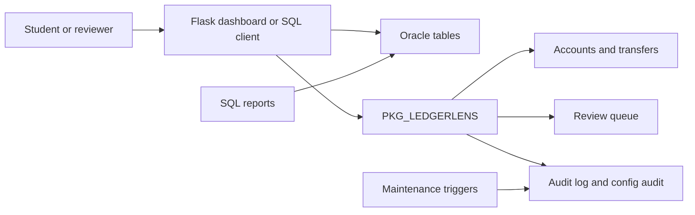

# LedgerLens Architecture

## Overview

LedgerLens keeps business decisions in Oracle. The optional Flask app is a presentation and data-access layer: it validates basic form shape, binds values, calls `PKG_LEDGERLENS`, and presents Oracle results. It does not reproduce transfer rules in Python.

## Transfer lifecycle

`CREATE_TRANSFER` inserts a request after basic key/amount checks, calls `VALIDATE_TRANSFER`, and either records a validation failure, creates a review hold, or delegates execution to `PROCESS_TRANSFER`. High-value means `amount >= HIGH_VALUE_THRESHOLD`.

- In `FLAG_AND_COMPLETE`, a high-value transfer is processed and then marked `risk_flag = Y` with one pending review record. This is the default classroom mode. A later decision dispositions the queue item only; it cannot re-execute or reverse the completed transfer.
- In `HOLD_FOR_REVIEW`, the transfer is set to `HELD_FOR_REVIEW` and queued without moving funds. Approval calls the package processor, which locks accounts and validates status/balance again. Rejection changes the transfer to `REJECTED` and leaves balances untouched.

The package does not commit. The invoking SQL session, dashboard request, or test script commits or rolls back its own transaction. The Python dashboard commits its package call after it returns. A caller can therefore group a package call with its own work, but must deliberately decide when to commit.

## Concurrency and failure handling

`PROCESS_TRANSFER` locks the transfer row so repeated calls serialize. It then locks source and destination account rows in ascending account ID order, checks current account states and available funds, and updates both balances as one Oracle transaction. The package savepoint lets processing roll back its own balance updates when an error occurs while preserving unrelated caller work made before the call. The outer caller still controls final commit/rollback.

This educational design demonstrates row locking and idempotent status checks; it is not a substitute for a production review of isolation, privileges, monitoring, operational recovery, or throughput.

## Object responsibilities

| Object | Responsibility |
|---|---|
| `PKG_LEDGERLENS` | Validation, request creation, safe execution, threshold changes, flags and review decisions |
| `TRG_ACCOUNTS_UPDATED_AT` | Maintain `accounts.updated_at` on every row update |
| `TRG_TRANSFERS_STATUS_AUDIT` | Insert one generic audit event for each status transition |
| `AUDIT_LOG` | Domain lifecycle and status history per transfer |
| `CONFIG_AUDIT` | Previous/new threshold values and the database user who changed them |
| `SYSTEM_OPERATORS` / `SYSTEM_REVIEWERS` | Database-session authorization lists for threshold changes and review decisions |
| `REVIEW_QUEUE` | Pending and completed reviewer decisions |
| `05_reports.sql` | Read-only examples for operations and demonstration |

Package actions record domain events such as creation, validation, flagging, execution and review. The status trigger independently records state transitions. Thus a state change may have both a domain event and a generic status event; these entries have different meanings and are intentional.

## Optional Flask request path

Forms use POST with a session CSRF token. SQL values are passed as binds. The Python database layer opens a connection per request operation and uses PL/SQL package calls for changes. Oracle configuration comes from environment variables or a local `.env` file (ignored by Git). Dashboard access and reviewer identity are intentionally lightweight and local-only; see [security and limitations](SECURITY_AND_LIMITATIONS.md).
