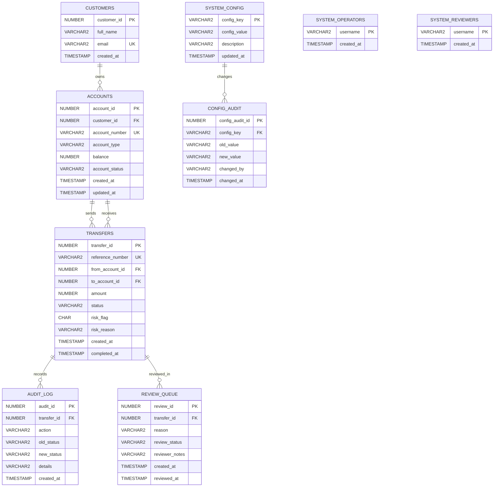

# LedgerLens ER Diagram

The ER model uses two named relationships from `ACCOUNTS` to `TRANSFERS` because each transfer references one source and one destination account. `SYSTEM_OPERATORS` controls package access to threshold updates and is not a customer entity.
